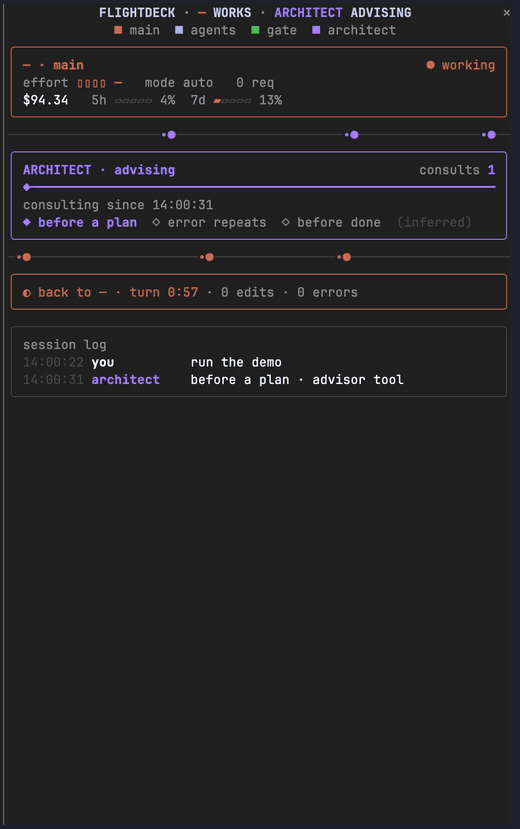

# Flightdeck

Flightdeck shows a live dashboard in a Claude Code pane: context and cost, an architect timeline, every permission check, and your subagents.

Part of [Sandeep Mods](https://github.com/Sandy3122/claude-mods) · Cost and usage



## What it does

- Shows the main model, effort, permission mode, context gauge, compactions, cost and the first two rate-limit windows your plan reports.
- Draws a timeline of consults with the architect (an advisor agent or server tool), and the first line of its advice when it is a subagent.
- Shows one cell for every permission check: allowed by a rule, decided then run, pending or denied. You can drill into files, shell and other tools.
- Shows each subagent as a card with its task, context and output tokens, steps and clock. With more agents than fit, it switches to swimlanes on one time axis.
- Adds a receipt for the running or last turn (duration, agents, edits, errors, cost added) and a session log.
- Puts context, running agents, consults and denials in the status line.

## Install

```
/plugin marketplace add Sandy3122/claude-mods
/plugin install flightdeck@sandeep-mods
```

## Use

- **Open and close.** `/flightdeck` opens the pane and `/flightdeck close` closes it. `/flightdeck reset` clears agents, checks, consults, the log and the turn; cost, rate limits and compactions stay. `/clear` also resets the pane.
- **Layout.** `/flightdeck layout auto|compact|wide|mini` overrides the layout for this session. In a fullscreen terminal the pane docks beside the transcript, in two columns from 110 columns wide. On the main screen it sits above the prompt as a summary of at most 8 rows.
- **Keys.** Focus the pane with `ctrl+x tab`. Press `1`, `2` and so on to expand an agent card or lane. Press `f`, `s` or `o` to open the file, shell or other drill-down of the gate.
- **Open on start.** With `openOnStart`, the pane opens by itself in terminals at least 144 columns wide. Below that, run `/flightdeck`.
- **Inferred values.** Architect moments ("before a plan", "error repeats", "before done") are guesses and are labelled `(inferred)`. A server-side advisor's reply is encrypted, so the pane counts the consult but cannot show what it said. Per-agent figures are the latest request's context, not a cost.

## Settings

| Option | Default | What it does |
| --- | --- | --- |
| `architectPattern` | `advisor\|architect` | Case-insensitive regular expression for the agent types and server tools that count as the architect |
| `architectLabel` | `ARCHITECT` | Name shown for the architect panel |
| `gateLabel` | `GATE` | Name shown for the permission panel |
| `panels` | `main,architect,gate,agents,loops,receipt,log` | Panels to show, in order; leave one out to hide it |
| `motion` | `while-active` | `off` keeps the connectors still |
| `moments` | `true` | Shows the inferred moment of each consult |
| `matchDescriptions` | `false` | Also counts an agent as the architect when its description matches the pattern |
| `maxCards` | `3` | Agent cards side by side before swimlanes (1 to 6) |
| `layout` | `auto` | `auto`, `compact`, `wide` or `mini` |
| `palette` | `theme` | `theme` follows your Claude Code theme; `pastel` uses fixed colours for dark terminals |
| `openOnStart` | `true` | Opens the pane when a session starts |
| `statusLine` | `true` | Shows context, agents, consults and denials in the status line |

Change them in `/plugin` → **Installed** → **flightdeck** → **Configure options**, or run `claude plugin configure flightdeck@sandeep-mods`.

## Requirements

- Claude Code 2.1.287+ (terminal or desktop app Code tab).
- The desktop app, VS Code and mobile draw the same panels with agents on an SVG time axis. VS Code and mobile can't animate, so connectors and clocks stay still there.

## What it can access

- **Hooks:** session start and end; the `/flightdeck` command; prompt submission (to read the permission mode); agent offers and spawns; turn start, steps and completion; context measurements and compactions; permission checks; tool calls; session rows; and the pane.
- **Reads:** each tool call's name, input and whether it failed; every permission verdict; subagent requests, token usage and final answers; the first 70 characters of your prompts, for the log; context, cost and rate-limit readings from Claude Code; and the assistant's advisor tool calls (their content is encrypted).
- **Keeps:** short summaries, such as a tool name plus a path or command with credentials masked, in session state. They end with the session. Nothing is kept across sessions.
- **Runs programs, writes files, network, models:** none. It makes no network requests, starts no processes, reads and writes no files, and calls no model, so it costs no tokens.
- **Gating:** it only watches. Its hooks pass every event on unchanged and never deny, rewrite, delay or approve a tool call, prompt or subagent.

## Troubleshooting

- **The pane doesn't appear.** Check `claude --version` is 2.1.287 or newer, then run `/reload-plugins` and `/flightdeck`. Below 144 columns the pane doesn't open by itself; `/flightdeck` opens it at any width. A dim transcript line starting `flightdeck:` names the hook that failed or why the pane was refused.
- **Colours look wrong.** Set `palette` to `pastel`.
- **There is too much motion.** Set `motion` to `off`.
- **Counters look stale after an update.** Run `/flightdeck reset`. A change to the state's shape may reset counters once.

## License

MIT; see LICENSE.

## Credits

Adapted and maintained by Sandeep as part of Sandeep Mods. Originally created by [scasella](https://github.com/scasella) in [scasella/claude-flightdeck](https://github.com/scasella/claude-flightdeck/tree/f31daca523d36c501cd0df23a737a44c7dc56ad6), MIT.
