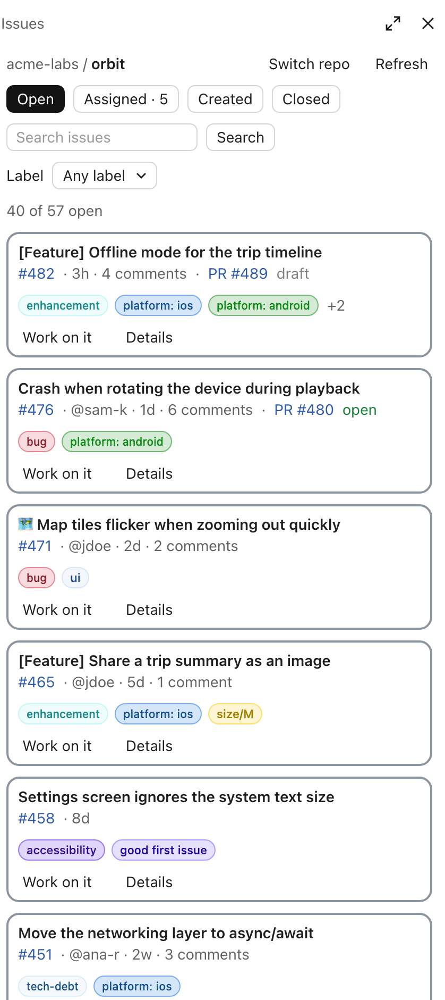
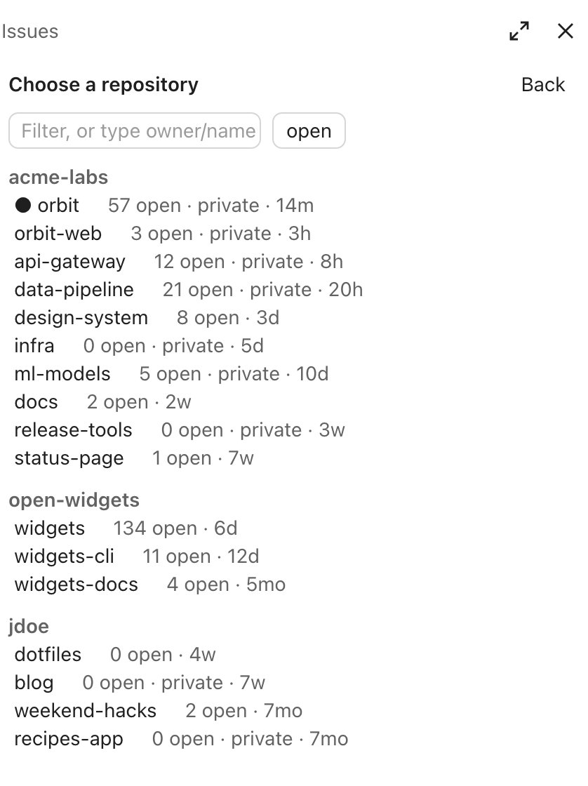

# GitHub Issues

GitHub Issues lists a repository's issues as cards in a side pane, with a button that has Claude work on one.

Part of [Sandeep Mods](https://github.com/Sandy3122/sandeep-mods) · Git and deploys

<p>
  
  
</p>

*Screenshots show made-up repositories, people and issues.*

## What it does

- Shows issues on four tabs: Open, Assigned (with your count), Created and Closed.
- Searches issues (Enter runs a GitHub search) and filters them by label. **Clear** resets both.
- Draws each issue as a card: title, `#number` (opens the issue on GitHub), assignees, last update, comment count, linked pull request (open, draft, merged or closed), and labels as pills in GitHub's colors.
- Shows an issue's description inside its card, and has a **Work on it** button that sends Claude a prompt to read the issue and its comments, plan, and implement it.
- Raises a toast when an issue is newly assigned to you.
- Lets you pick any repository you can reach, with its open issue count.

## Install

```
/plugin marketplace add Sandy3122/sandeep-mods
/plugin install github-issues@sandeep-mods
```

## Use

| Command | What it does |
| --- | --- |
| `/issues` | In a folder whose repository is on GitHub, shows that repository's issues. Anywhere else, opens the repository picker. |
| `/issues owner/name` | Shows that repository's issues. |
| `/issues .` | Shows the session's repository (from the `origin` remote). |

- **The pane.** It shows the 40 most recently updated issues that match. A spinner shows while it loads. The list refreshes when you open the pane, after each of Claude's turns, every two minutes, and when you press **Refresh**. If too many cards fit the pane at once, it shows as many as fit and says how many more there are. Use search or a label to narrow the list.
- **The picker.** It lists the 30 repositories you pushed to most recently (yours, ones you collaborate on, and your organizations'), grouped by owner. Type in the filter box to narrow the list. Enter opens the first match, or any `owner/name` you type. **Switch repo** in the pane goes back to the picker.
- **Work on it.** The button sends Claude a message asking it to read the issue with `gh issue view`, outline a plan, implement it, and mention the issue number in the commit and pull request. The issue's card gets an accent border while Claude works on it.
- **Assignment alerts.** While the pane is open, the mod checks every two minutes which open issues are assigned to you in the repository it is watching. The first check of a repository is silent. After that, each newly assigned issue raises a toast. The issue numbers already seen are kept between sessions.
- **Reopening.** If you leave the pane open, it opens again in your next session.

## Settings

None.

## Requirements

- Claude Code 2.1.287+ (terminal or desktop app Code tab).
- The [GitHub CLI](https://cli.github.com) (`gh`), signed in with `gh auth login`. The mod looks for `gh` on your path, then in `/opt/homebrew/bin` and `/usr/local/bin`.

## What it can access

- **Hooks:** session start, the `/issues` command, the end of each of Claude's turns, closing the pane, and drawing the pane.
- **Runs programs:** only `gh`, on your machine: `gh --version` to find it, `gh api graphql` (issues, labels, assigned issues, repositories) and `gh issue view` (an issue's description and comments). It also asks Claude Code for the session's repository.
- **Network:** requests to GitHub, made by `gh` with your `gh` sign-in. Nothing else leaves your machine. With the pane closed, it makes no requests.
- **Model calls:** it calls no model itself. **Work on it** submits one ordinary message to Claude, only when you press it, and that message costs tokens like any other.
- **Writes files:** none in your project. It keeps in the mod's own store whether the pane was open, and the issue numbers already seen per repository.
- It never approves or changes tool calls.

## Troubleshooting

- **"The GitHub CLI (gh) was not found."** Install `gh` from cli.github.com, then restart Claude Code.
- **The pane shows an error from `gh`.** Run `gh auth status` in a terminal. If you are signed out, run `gh auth login`. Private and organization repositories need a sign-in that can reach them.
- **`/issues` opens the picker instead of issues.** The session's folder has no GitHub `origin` remote. Pick a repository, or run `/issues owner/name`.
- **No assignment toasts.** The first check of a repository only records the current issues. The pane must be open for checks to run.

## License

MIT; see LICENSE.

## Credits

Adapted and maintained by Sandeep as part of Sandeep Mods. Originally created by MarcoCarnevali, MIT.
