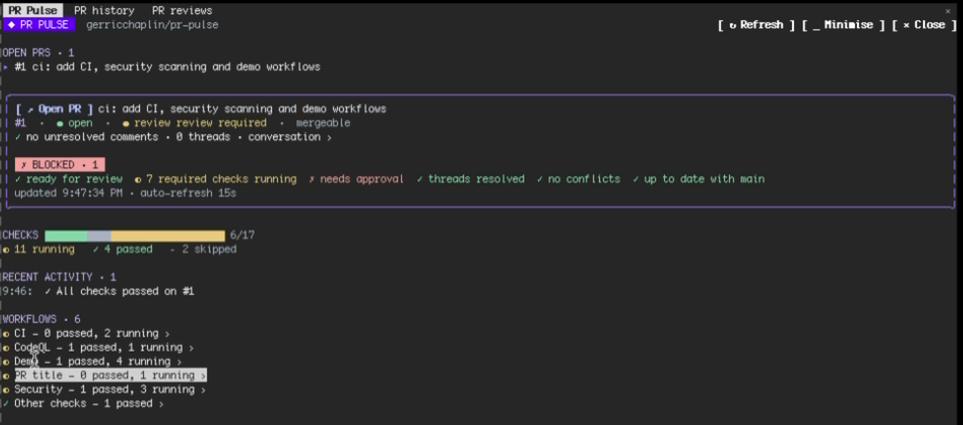

# PR Pulse

PR Pulse shows live status for your GitHub pull requests in Claude Code: checks, merge readiness, review comments, your review queue and change alerts.

Part of [Sandeep Mods](https://github.com/Sandy3122/claude-mods) · Git and deploys



## What it does

- Opens three tabbed panes: PR Pulse (your open PRs), PR history and PR reviews.
- Shows a merge-readiness verdict for the selected PR (ready to merge, blocked, or waiting on checks) with the checklist behind it.
- Lists checks with failed ones first, and lets you drill from a workflow to its jobs and steps, with an excerpt of the failure log.
- Lists unresolved review threads, the conversation and resolved threads.
- Lists PRs you opened, PRs merged in the last 7 days, and PRs waiting for your review or your teams' review.
- Raises a toast and adds a line to the recent-activity list when a check fails, all checks pass, a review lands, someone comments, a PR becomes ready to merge or a review is requested from you.
- Drafts a prompt from a failed check or a review thread and puts it in your prompt box. Nothing is sent until you press Enter.

## Install

```
/plugin marketplace add Sandy3122/claude-mods
/plugin install pr-pulse@sandeep-mods
```

## Use

Run `/pulse` in a GitHub repo. It takes an optional argument: `owner/repo`, `owner/repo#123` or a PR URL. With no argument it watches your latest open PR in the repo you are in.

Keys while a pane is focused:
- **r** refreshes.
- **m** minimises the panes to a one-line band above the prompt. Polling and alerts carry on.
- **q** closes PR Pulse.
- **o** opens the PR in your browser.

Run `/pulse` again, or press **e** in the band, to expand the panes. The band shows each open PR with its state, the number of PRs waiting on your review, and the latest alert.

The **Fix with Claude** and **Address with Claude** buttons add a draft to your prompt box. If you change folder, PR Pulse follows the new repo.

PR Pulse polls GitHub, because a local plugin cannot receive webhooks. It refreshes your PRs and checks every 15 seconds, and history, the review queue and branch status every 60 seconds.

## Settings

None. The panes follow your Claude Code theme (dark or light).

## Requirements

- Claude Code 2.1.287+ (terminal or desktop app Code tab).
- The [GitHub CLI](https://cli.github.com) (`gh`), signed in. Check with `gh auth status`.
- `git`, to find the repo you are in.
- `open` on macOS or `xdg-open` elsewhere, to open links in your browser.

## What it can access

- **Hooks:** session start, a change of folder, the `/pulse` command, closing the PR Pulse pane, and the drawing of the three panes and the band above the prompt. None of them can refuse or rewrite a tool call.
- **Runs programs:** `gh`, `git`, `uname` and `open` or `xdg-open`. It runs nothing else.
- **`gh` commands:** `gh repo view`, `gh pr list` (your PRs, merged PRs, and PRs that request your review), `gh pr view`, `gh pr checks`, `gh run view` (jobs and the failed-job log) and `gh api` (your user, repo compare, and GraphQL queries for review threads and comment counts). All of them read. PR Pulse never creates, comments on, approves or merges anything.
- **Network:** every request goes through `gh` to GitHub, as your signed-in user. Calls count against your own GitHub rate limits. It makes no other network requests.
- **Opens links:** only `https://` URLs, in your default browser, when you ask.
- **Prompt box:** it reads your prompt text and appends a draft. It never submits it.
- **Writes files:** none. State is kept in memory for the session.
- **Models:** none are called, so it costs no tokens.

## Troubleshooting

- **Nothing shows, or an error appears.** Run `gh auth status` and sign in with `gh auth login`. Then run `/pulse` again.
- **"No PRs of yours in owner/repo".** PR Pulse watches PRs you opened in the current repo. Pass `owner/repo#123` or a PR URL to watch a specific one.
- **The wrong repo is watched.** Run `/pulse owner/repo` to pick one, or change into the repo folder.
- **The draft did not appear in the prompt.** A dialog may be open. Close it and press the button again.
- **GitHub rate limit errors.** Close PR Pulse with **q** while you run other heavy `gh` work. It shares your token's hourly limit.

## License

MIT; see LICENSE.

## Credits

Adapted and maintained by Sandeep as part of Sandeep Mods. Originally created by [gerricchaplin](https://github.com/gerricchaplin) in [gerricchaplin/pr-pulse](https://github.com/gerricchaplin/pr-pulse/tree/8bf587aaa9cb3815875dcc3818c8827a37e7cb78), MIT.
