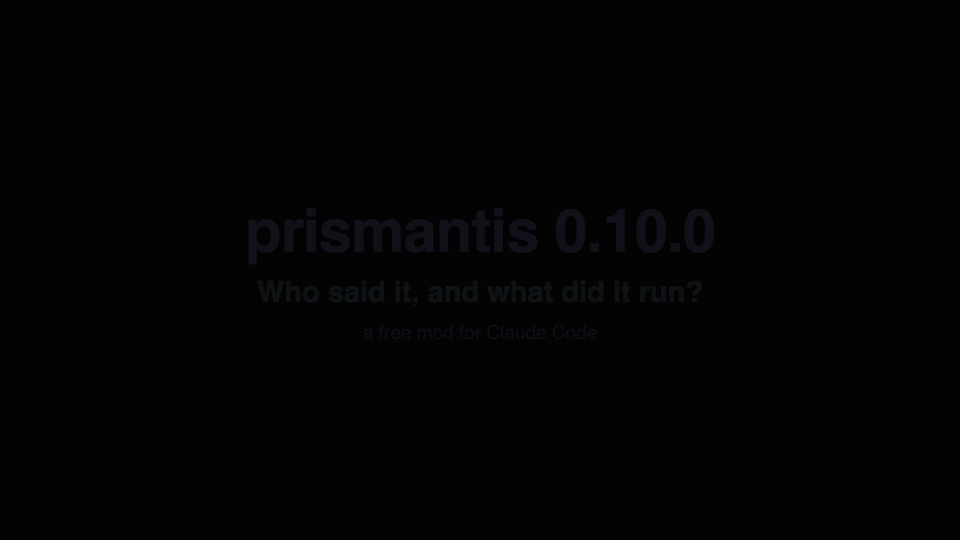

# Prismantis

Prismantis redraws Claude Code replies in a color theme you pick: tables, headings, code, diagrams, tool rows and your own prompts.

Part of [Sandeep Mods](https://github.com/Sandy3122/sandeep-mods) · Viewing output



## What it does

- Draws replies and slash command output as markdown in a theme: headings, lists, task lists, quotes, alerts, tables, bold, italic, links, and highlighted numbers and file paths.
- Highlights code blocks with a language header, using Prism for 24 languages and its own coloring for shell blocks.
- Draws ` ```mermaid ` blocks as colored text diagrams: flowcharts, sequence, state, class and ER diagrams, and bar and line charts.
- Adds copy buttons to code blocks, tables, diagrams, lists, quotes and whole replies.
- Shows tool calls as one compact line each (`Ran gh pr view 12`, `Read ~/src/app.ts`) and groups them when they are collapsed.
- Draws Hebrew and Arabic right to left, and puts your own prompts in a bubble, bar or chevron.

## Install

```
/plugin marketplace add Sandy3122/sandeep-mods
/plugin install prismantis@sandeep-mods
```

## Use

Replies are drawn as soon as the mod is loaded. Pick a theme and styles in the settings below, or use the `/prismantis` command:

| Command | What it does |
| --- | --- |
| `/prismantis` | Shows a help screen with the commands and every theme |
| `/prismantis theme <name>` | Switches the theme now and saves it as the `theme` setting |
| `/prismantis copy` | Copies the last reply to the clipboard |
| `/prismantis copy code` | Copies the last code block of the last reply |
| `/prismantis demo` | Prints a sample of every element and diagram |
| `/prismantis demo-rtl` | Prints a Hebrew right-to-left sample |

Each copy button is drawn in the transcript. Click it where your terminal passes clicks through. Without a mouse, use `/prismantis copy`. Press ctrl+o on a reply to see Claude Code's original drawing.

Notes:
- A mermaid diagram that is wider than the window, or longer than 80 lines, stays as code. Pie charts are not drawn.
- The parser covers what Claude usually writes. Nested quotes and HTML draw as plain text.
- Languages outside the 24 Prism ones draw in the code text color.
- Set `enabled` to off to get Claude Code's own renderer back.

## Settings

Change them in `/plugin` → **Installed** → **prismantis** → **Configure options**, or run `claude plugin configure prismantis@sandeep-mods`. Color options take a hex value (`#a6e3a1`), `rgb(166,227,161)`, `ansi256(114)` or a color name (`green`). Empty uses the theme.

**General**

| Option | Default | What it does |
| --- | --- | --- |
| `enabled` | `true` | Draws replies with this mod; off falls back to Claude Code's own renderer |
| `theme` | `catppuccin-mocha` | Base palette: `catppuccin-mocha`, `catppuccin-latte`, `dracula`, `nord`, `tokyo-night`, `gruvbox-dark`, `gruvbox-light`, `rose-pine`, `rose-pine-dawn`, `everforest`, `github-dark`, `github-light`, `one-dark`, `solarized-dark`, `solarized-light` or `mono` (bold and dim only) |
| `headingStyle` | `banner` | Heading look: `banner` (box around H1, heavy rule under H2), `bold`, `underline` or `uppercase` (H1) |
| `tableStyle` | `box` | Table look: `box`, `rules`, `grid` or `minimal` |
| `promptStyle` | `bubble` | How your prompts draw: `bubble`, `bar`, `chevron` or `off` |
| `toolStyle` | `chat` | Where tool rows sit: `chat` (dimmed, on the right), `tree-dim`, `tree-bold` or `classic` |
| `taskStyle` | `checks` | How `- [ ]` and `- [x]` items draw: `checks`, `ticks`, `box` or `progress` |
| `toolRows` | `true` | Draws tool calls as one compact line; results still draw below |
| `rtl` | `auto` | Right-to-left handling for Hebrew and Arabic: `auto` detects the terminal; or pick `warp`, `kitty`, `apple-terminal`, `iterm`, `ghostty`, `wezterm`, `vscode`, `alacritty`, `windows-terminal`, `gnome`, `konsole`, or `off` |
| `highlightNumbers` | `true` | Colors versions, IDs, counts and durations in prose and tables |
| `highlightPaths` | `true` | Colors file paths such as `~/src/app.ts` |
| `copyButtons` | `true` | Adds copy buttons to code, tables, diagrams, lists and quotes |

**Diagrams**

| Option | Default | What it does |
| --- | --- | --- |
| `mermaid` | `true` | Draws mermaid blocks as colored text diagrams; off leaves the code as written |
| `mermaidAscii` | `false` | Draws diagrams with `+ - |` instead of box-drawing characters |
| `diagramHints` | `true` | Adds a short note, for the model only, to each prompt you type (see What it can access); off when `mermaid` is off |
| `diagramColor` | empty | Color of diagram boxes and arrows |
| `diagramTextColor` | empty | Color of diagram labels |

**Colors**

| Option | Default | What it does |
| --- | --- | --- |
| `accentColor` | empty | Reply bullet, H3 and smaller headings, quote bars |
| `headingColor` | empty | H1 and H2 headings |
| `tableHeaderColor` | empty | Table header cells |
| `tableRuleColor` | empty | Table rules |
| `numberColor` | empty | Versions, IDs and counts |
| `pathColor` | empty | File paths |
| `linkColor` | empty | Links and URLs |
| `inlineCodeColor` | empty | `Inline code` |
| `codeTextColor` | empty | Code block text |
| `codeCommandColor` | empty | The command word in shell blocks |
| `codeFlagColor` | empty | `--flags` in shell blocks |
| `codeStringColor` | empty | Quoted strings in shell blocks |
| `codeCommentColor` | empty | `#` comments in shell blocks |
| `strongColor` | empty | **Bold** text |
| `emphasisColor` | empty | *Italic* text |
| `quoteColor` | empty | Block quotes |
| `ruleColor` | empty | Horizontal rules and heading banners |
| `bulletColor` | empty | List bullets and numbers |

## Requirements

- Claude Code 2.1.287+ (terminal or desktop app Code tab).
- A terminal that shows 24-bit color and box-drawing characters; set `mermaidAscii` if your font lacks them.
- Right-to-left text works best in the terminals listed under the `rtl` option.

## What it can access

- **Hooks:** it redraws assistant replies, your prompts, slash command output, tool calls and tool groups, and the turn-duration line. It adds the `/prismantis` command, and a `$.prismantis.markdown` call that other mods can use to draw markdown in your theme.
- **Prompt change:** with `diagramHints` on, it adds a short note of about 190 tokens to each prompt you type in the composer. The model reads it; you never see it. It tells the model that tables, code, mermaid diagrams and charts draw here, and asks for commands in fenced blocks. This costs tokens on every prompt. It makes no model calls of its own.
- **Reads:** the terminal environment variables `TERM`, `TERM_PROGRAM`, `KITTY_WINDOW_ID`, `ALACRITTY_WINDOW_ID`, `WT_SESSION`, `VTE_VERSION` and `KONSOLE_VERSION` to detect your terminal for right-to-left text. For `/prismantis copy` it reads the last assistant message of the session.
- **Writes:** the clipboard, when you press a copy button or run `/prismantis copy`. `/prismantis theme` changes the `theme` plugin setting. It writes no files of its own.
- **Programs and network:** none. It runs no programs and makes no network requests.

## Troubleshooting

- **Replies look like Claude Code's own.** Check that `enabled` is on and run `/reload`. A session keeps the version it loaded until it reloads.
- **Box lines or diagrams look broken.** Your font may lack box-drawing characters. Turn on `mermaidAscii`, or pick a different font.
- **Hebrew or Arabic letters come out in the wrong order.** Leave `rtl` on `auto`, or pick your terminal by name. Numbers next to Latin text can still land on the wrong side in some terminals.
- **A copy button does nothing when clicked.** Some terminals do not pass clicks through. Use `/prismantis copy` instead.
- **A diagram shows as code.** It is wider than the window or over 80 lines. Widen the window or ask Claude for a smaller one.

## License

MIT; see LICENSE. The bundled libraries (beautiful-mermaid and Prism) and the color palettes are MIT too; their notices are in `docs/THIRD_PARTY_NOTICES.md`.

## Credits

Adapted and maintained by Sandeep as part of Sandeep Mods. Originally created by NahumLitvin, MIT.
