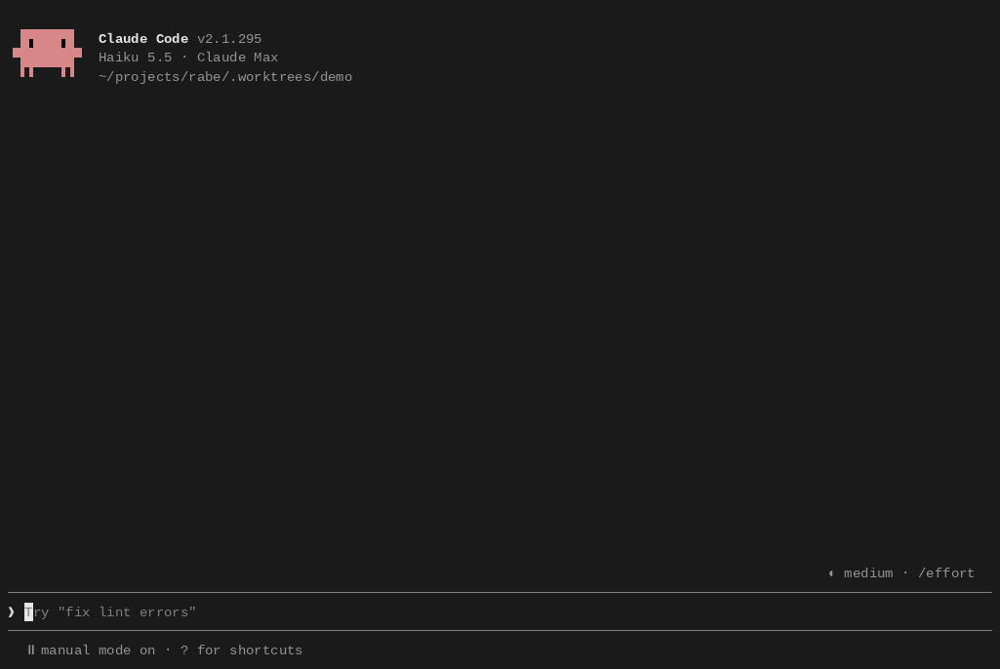

# Rabe

Rabe shows the subagents, Codex jobs, shells, monitors, cron jobs and workflows that run in the background of your Claude Code session.

Part of [Sandeep Mods](https://github.com/Sandy3122/claude-mods) · Workflow



## What it does

- Draws a band above the prompt that lists what runs now: Claude subagents, workflows, Codex jobs, background shells, monitors, and cron jobs or `/loop` wakeups. It draws nothing when nothing runs.
- Puts failures from the last 10 minutes first. When the rows don't fit, it shows one line of counts.
- Opens a pane with `/rabe`. The pane has four tabs: Items, Cost, Effects and Timeline.
- Shows per-item detail: tokens, the prompt an agent got, each turn and tool call, shell output, monitor lines, the next five cron runs, and the phases of a workflow.
- Warns when two agents edit the same file, and lists worktrees and open ports with the `ssh -L` command to reach them.
- Lets you stop an item, stop a group, message an agent, copy a command, or delete a cron job from the pane.

## Install

```
/plugin marketplace add Sandy3122/claude-mods
/plugin install rabe@sandeep-mods
```

## Use

The band appears by itself while background work runs. Type `/rabe` to open the pane. In the terminal the pane docks beside the transcript; drag its left edge to make it wider. At 90 columns or more, the selected item shows beside the list.

| Key | What it does |
| --- | --- |
| `j` / `k` | Move down or up |
| Enter | Open the selected item |
| `b` | Back to the list |
| `1` to `4` | Switch tab |
| `s` | Search |
| `x` | Stop the selected item |
| `g` | Stop the whole group, or a workflow run |
| `m` | Send a message to an agent |
| `c` | Copy the command, the prompt or the `ssh -L` line |
| `d` | Delete a cron job |
| Esc | Close the pane |

The buttons under the pane show the keys that work on the current tab. A letter with no button goes to the prompt.

Tabs:

- **Items**: everything, grouped by kind, with a search field.
- **Cost**: the session cost as `/cost` totals it, a bar of tokens per agent and Codex job, and agents that look slow or stuck.
- **Effects**: files agents edited, worktrees, and open ports.
- **Timeline**: a bar per item over the session, who started what, and a summary of the previous session in this project.

Commands:

- `/rabe`: open the pane.
- `/rabe-stop codex:<job id>`: cancel a running Codex job. `x` in the pane does the same.
- `/rabe:report-bug`: draft a bug report for the original project's GitHub repository.
- `/rabe:feedback`: draft an idea or comment for the same repository.

The two report commands show you a draft first and create a public GitHub issue only after you say yes. Without the `gh` CLI, they give you a link to open instead. The issues go to the Sandeep Mods repository, `Sandy3122/claude-mods`, and their titles start with `[rabe]`.

## Settings

| Option | Default | What it does |
| --- | --- | --- |
| `hideBuiltinTasks` | `true` | Hides Claude Code's own count of shells and monitors (and its "↓ to manage") under the prompt, and the "still running" part at the end of a turn, because the band shows them. The agent list under the prompt can't be hidden. |

Change it in `/plugin` → **Installed** → **rabe** → **Configure options**, or run `claude plugin configure rabe@sandeep-mods`.

## Requirements

- Claude Code 2.1.287+ (terminal or desktop app Code tab). The mod is built and tested on 2.1.295; other versions can show `n/a` where a file layout changed.
- The colored band and pane draw in the terminal. The desktop app shows the same content as text and buttons.
- Optional: the Codex plugin (`codex@openai-codex`) for Codex jobs, and the `gh` CLI for the report commands.
- `tail` on your path. `node` is needed only to stop a Codex job.

## What it can access

- **Hooks:** tool calls (`Bash`, `Monitor`, `Workflow`, `Edit`, `Write`, `CronCreate`, `CronDelete`, `ScheduleWakeup`), subagent starts and steps, turn ends, task notifications and scheduled triggers, session start and end, and the `/rabe` and `/rabe-stop` commands. It draws the band above the prompt and the pane. These hooks observe and pass events on.
- **Reads files:** subagent meta files next to the session transcript under `~/.claude/projects/`; workflow scripts (for phase names); shell and monitor output files under `/tmp/claude-<uid>/`; the Codex plugin's job files under `~/.claude/plugins/data/codex-openai-codex/` and `~/.claude/plugins/installed_plugins.json`; and Codex session files under `~/.codex/sessions/`. It honors `CLAUDE_CONFIG_DIR`, `CODEX_HOME` and `HOME`.
- **Runs programs:** `tail` to read the end of large shell output and Codex session files. When you stop a Codex job, it runs `node` on the Codex plugin's own cancel script.
- **Calls tools on your behalf:** `TaskStop` to stop a shell, monitor or agent, `CronList` to read cron jobs, and `CronDelete` to delete one, only when you press the key. It can send a message to an agent you pick with `m`.
- **Writes:** no files. It keeps its items in session state, and a short summary of each session (counts per kind, tokens, cost, names of failed items) in the mod's own store, for the next session in the same project.
- **Network and models:** it makes no network requests and calls no model itself. The report commands ask Claude to write a draft, which uses tokens, and may run `gh issue create` after you approve it.

## Troubleshooting

- **The band is empty.** It draws only while something runs. Work that started before the mod loaded shows only what the agent list, `CronList` and the files report.
- **A value shows `n/a`.** Rabe reads files that Claude Code and Codex don't document. A missing file or changed layout shows as `n/a`.
- **No dollars per agent.** No source gives them. The Cost tab shows tokens per worker and the session total.
- **A shell's port is wrong.** The port is a guess from the shell's output.
- **Claude Code's own background count is still there.** Check that `hideBuiltinTasks` is on, then restart Claude Code.

## License

MIT; see LICENSE.

## Credits

Adapted and maintained by Sandeep as part of Sandeep Mods. Originally created by [lorenzh](https://github.com/lorenzh) in [lorenzh/rabe](https://github.com/lorenzh/rabe/tree/8edd5cd579f49c2ca95128e815b8d16e002c2a2d), MIT.
