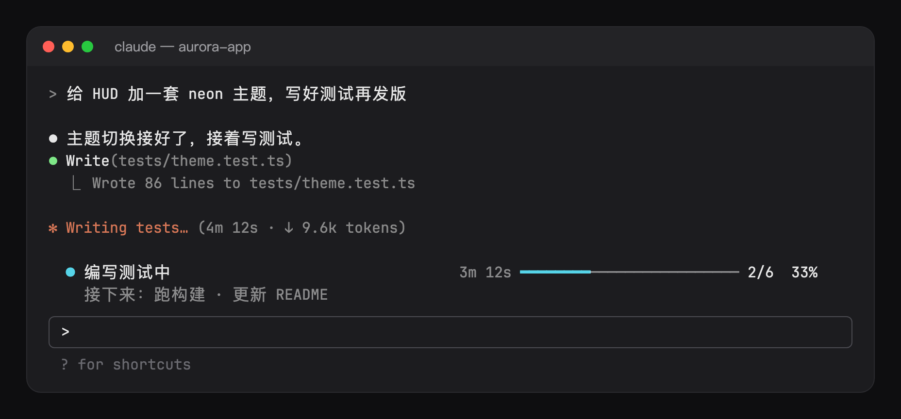
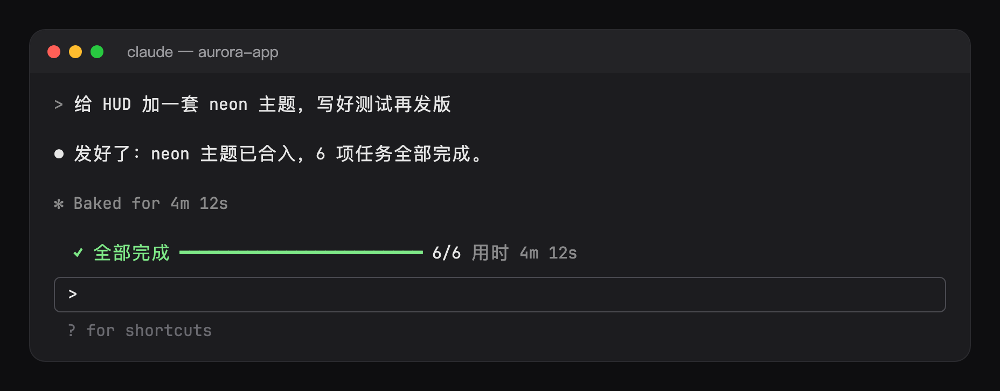

# Todo Bar

Todo Bar shows how far Claude is through its task list, in a band above the prompt.

Part of [Sandeep Mods](https://github.com/Sandy3122/claude-mods) · Workflow



## What it does

- Shows the running task, a progress bar, the count and the percentage, with the next one or two tasks in a dim second row.
- Times the running task. After a minute its time appears, and it turns yellow once it passes the slow limit (10 minutes by default).
- Adds a row under the running task for each subagent still at work: its type, its task, the tool it is on and how long it has run. Past three rows, the rest share one row.
- When every task is done, the band turns green with the time the whole list took, then folds away after 8 seconds. The next list brings it back.
- Keeps each session's list in the mod's store, so a resumed session finds its band where it left it.
- Steps aside while a `/` or `@` picker is open.



## Install

```
/plugin marketplace add Sandy3122/claude-mods
/plugin install todo-bar@sandeep-mods
```

## Use

The band appears above the prompt once Claude writes a task list with `TodoWrite`, or creates tasks with `TaskCreate` and `TaskUpdate`. A subagent's own list is left out.

| Command | What it does |
| --- | --- |
| `/todos` | Lists every task with its mark (`✓` done, `●` running, `○` waiting), how long it ran, the tool calls the main thread made meanwhile and the subagents it started. |
| `/todos off` | Hides the band and saves that as the `visible` setting. |
| `/todos on` | Shows the band again and saves that as the `visible` setting. |

## Settings

Set these in `/config`.

| Option | Default | What it does |
| --- | --- | --- |
| `visible` | on | Shows the band. `/todos off` and `/todos on` set it too. |
| `showNext` | on | Shows a dim second row with the next one or two tasks. |
| `showAgents` | on | Shows a row under the running task for each subagent still at work. |
| `slowMinutes` | 10 | The running task's time turns yellow after this many minutes. 0 never turns it yellow. |
| `language` | auto | Language of the band and `/todos`: `auto`, `en`, `zh-Hans`, `zh-Hant`, `ja`, `ko`, `es`, `fr`, `de`, `pt-BR` or `ru`. `auto` follows Claude Code's language setting, then the system locale, then English. |

## Requirements

- Claude Code 2.1.287+ (terminal or desktop app Code tab).

## What it can access

- **Hooks:** session start, subagent start, the end of each turn, every tool call, the `/todos` command, edits and submits in the prompt, and drawing the band above the prompt.
- **Tool calls:** it reads `TodoWrite`, `TaskCreate` and `TaskUpdate` after they have run, and counts other tool calls toward the running task. It registers no tool, adds nothing to the system prompt, and never refuses or changes a call. A refused or failed call changes nothing.
- **Model calls:** none. The mod makes no model call and costs no tokens.
- **Programs:** none. It starts no process. It asks Claude Code for the list of running subagents, which runs inside Claude Code.
- **Network:** none.
- **Reads:** your Claude Code settings (for the `language` setting) and the environment variables `LC_ALL`, `LC_MESSAGES` and `LANG`.
- **Writes:** no files in your project. It keeps each session's list in the mod's store (the newest 20 sessions). `/todos off` and `/todos on` write the `visible` setting through Claude Code's config.

## Troubleshooting

- **No band appears.** The band shows only after Claude writes a task list. Check that `visible` is on, or run `/todos on`.
- **The band is gone while you type.** It steps aside while a `/` or `@` picker is open and returns when the picker closes.
- **No subagent rows.** Turn on `showAgents`. Rows show only for subagents the main thread started, and a row leaves when its subagent ends.
- **The band is in the wrong language.** Set `language` to the one you want instead of `auto`.

## License

MIT; see LICENSE.

## Credits

Adapted and maintained by Sandeep as part of Sandeep Mods. Originally created by [hoobnn](https://github.com/hoobnn) in [hoobnn/hoobnn-agent-mods](https://github.com/hoobnn/hoobnn-agent-mods/tree/b95d1e454a76523e433fb37e5ca171e1f5576676/claude-code/todo-bar), MIT.
