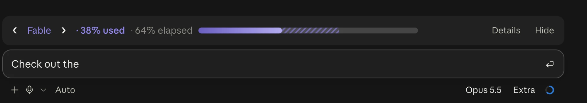
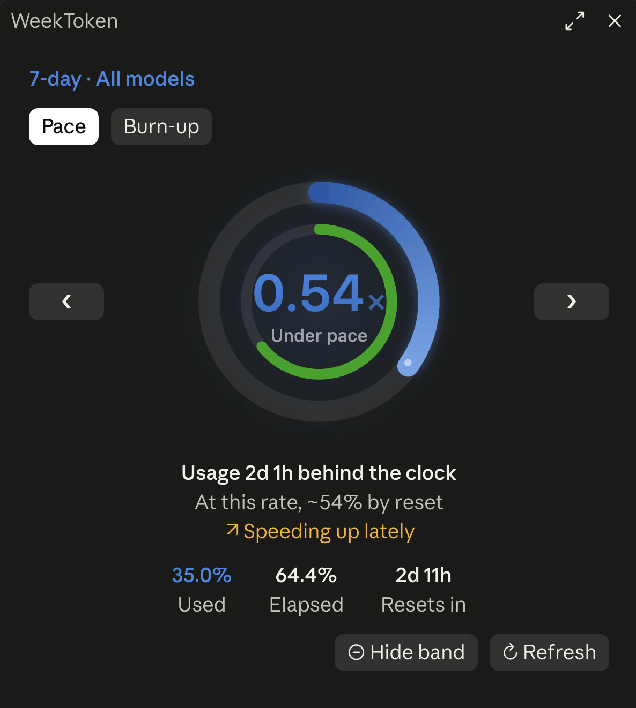
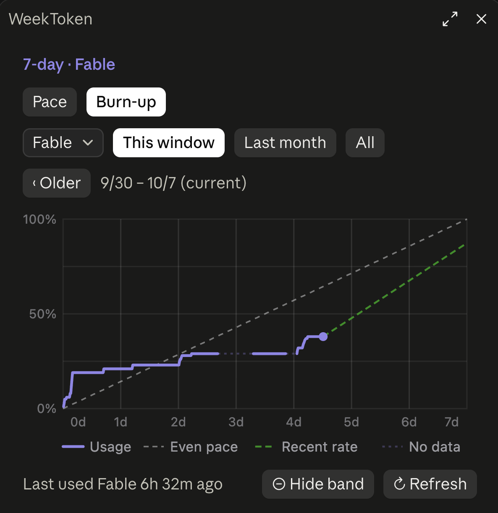
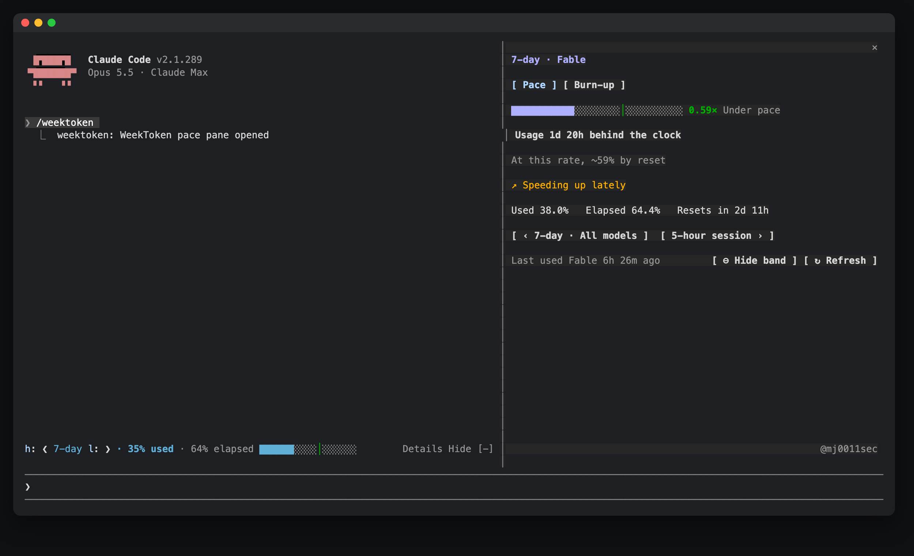

# WeekToken

WeekToken shows how much of your Claude Code usage limits you have used next to how much of each window has passed, so you can see if you will run out before the reset.

Part of [Sandeep Mods](https://github.com/Sandy3122/claude-mods) · Cost and usage



## What it does

- Draws a band above the prompt with one quota at a time: percent used, percent of the window elapsed, and a progress bar coloured by pace.
- Covers the 5-hour window, the 7-day window and per-model weekly quotas, such as Fable.
- Opens a `/weektoken` pane with pace rings, a plain-language forecast ("At this rate, runs out ~Sat 20:12") and the time left to reset.
- Draws a burn-up chart that lays past windows under the current one, for this window, the last month or all history.
- Shows the interface in English or Chinese, following Claude Code's language.

| Pace | Burn-up history |
| --- | --- |
|  |  |



## Install

```
/plugin marketplace add Sandy3122/claude-mods
/plugin install weektoken@sandeep-mods
```

## Use

| Command | What it does |
| --- | --- |
| `/weektoken` | Opens the pace pane. |
| `/weektoken hide` | Hides the band. The choice is kept between sessions. |
| `/weektoken show` | Shows the band again. |

- **The band.** It shows the tightest quota by default. The arrows around the quota name switch to another one, and the choice is remembered. The band and the pane always show the same quota. **Details** opens the pane and then reads **Close**. **Hide** asks first, then tells you how to get the band back. In the desktop app, the close button at the band's right end hides it. On a narrow band the elapsed figure is dropped first.
- **Colours.** The bar keeps the quota's own colour. Light stripes after the bar are the margin you have left. If you use faster than time passes, the part ahead of the clock turns a deeper, striped shade. A warm tone appears only when a quota is used up. Thresholds follow Claude Code's own rate-limit warnings and tighten as the window goes on.
- **After a reset.** When a window has passed its reset time and no new reading has arrived, the band says **reset** instead of the old usage.
- **The pane.** The outer ring is usage, the thin inner ring is time, and the centre is the burn rate (1.0 means you run out exactly at reset). Used, elapsed and time to reset sit beside the rings. Arrows by the title switch quota. Two tabs: pace and burn-up.
- **Burn-up chart.** It has an even-pace line, a projection at your recent rate and gaps where there was no data. Over 60 windows, it draws 60 evenly spaced ones and says so. In Last month and All, **Inspect lines** makes the chart hoverable; **Done** or any change of range, quota or tab turns it back into an image.
- **Footer.** It says when a quota was last used (after half an hour without change), and has **Hide band** or **Show band** and **Refresh**. A refresh takes about half a second.

## Settings

None. Three environment variables change defaults. Set them in your shell profile and start a new session.

| Variable | What it does |
| --- | --- |
| `WEEKTOKEN_LANG` | `zh` or `en` forces the language. Otherwise it follows Claude Code's language, then the system language. |
| `WEEKTOKEN_HISTORY` | Path of a history file written by the WeekToken macOS app. An empty value turns the import off. |
| `CLAUDE_MODS_DISABLE` | `all`, or a comma list containing `weektoken`, turns the mod off. |

## Requirements

- Claude Code 2.1.287+ (terminal or desktop app Code tab).
- A Claude subscription. Sessions billed by API key have no rate limits to show.
- macOS or Linux for the optional helpers (`tail`, `perl`, `defaults`); the band and pane work without them.

## What it can access

- **Hooks:** session start, each reply, session usage readings, the `/weektoken` command, button presses and focus on its own pane, changes to Claude Code's language setting, closing its pane, and drawing the band above the prompt and the pane.
- **Network:** one `GET` to `https://api.anthropic.com/api/oauth/usage`, only when you press **Refresh**. Claude Code attaches your login; the mod never sees the credential. No body is sent, no model is called and no quota is used. If you have no subscription login or the request fails, it runs `claude` instead (below).
- **Runs programs:** none through a shell, all with fixed arguments.
  - `claude -p --no-session-persistence /usage`, only on Refresh when the request above cannot be used. It saves no session. The mod looks for `claude` on your `PATH`, then in `~/.local/bin`, `~/.claude/local`, `/opt/homebrew/bin` and `/usr/local/bin`.
  - `defaults read -g AppleLanguages`, to read the macOS language when Claude Code's language is not set.
  - `tail -n 8000 ~/.weektoken/samples.jsonl`, at session start and every 10 minutes, if the file exists.
  - `perl` with one fixed pattern, only when `~/.claude.json` is over 4 MiB, to pull out its `cachedUsageUtilization` entry.
- **Reads files:** `~/.claude.json`, using only its `cachedUsageUtilization` entry (read at session start, every 5 minutes when it changed, and on Refresh); `~/.weektoken/samples.jsonl` or the file named by `WEEKTOKEN_HISTORY`; and the mod's own `plugin.json` for the version shown in the pane. It reads the environment variables `HOME`, `PATH`, `LANG`, `LC_ALL`, `LC_MESSAGES` and the three above. It reads no credentials.
- **Model calls:** none.
- **Writes files:** none. In the mod's own store it keeps up to 8000 usage samples, when each model was last used, whether the band is shown and which quota, the imported file's modification time and whether the welcome toast was shown.
- It never approves or changes tool calls.

## Troubleshooting

- **No band, or "unknown" figures.** Without a subscription login there are no limits to read. A new session shows figures after its first reply, or press **Refresh** in the pane.
- **A per-model quota such as Fable is missing or old.** Press **Refresh**. If it fails, a toast says `claude /usage` could not run; check that `claude` is on your `PATH`.
- **The band is gone.** You hid it. Run `/weektoken show`, or press **Show band** in the pane.
- **The history starts today.** The API reports only current values, so history begins when you install the mod, unless you import a file from the WeekToken macOS app.

## License

MIT; see LICENSE.

## Credits

Adapted and maintained by Sandeep as part of Sandeep Mods. Originally created by [3dnow](https://github.com/3dnow) in [3dnow/claude-mods](https://github.com/3dnow/claude-mods/tree/9f0bf8e119a1444fc267b9553da88c6b444f3683/weektoken), MIT.
